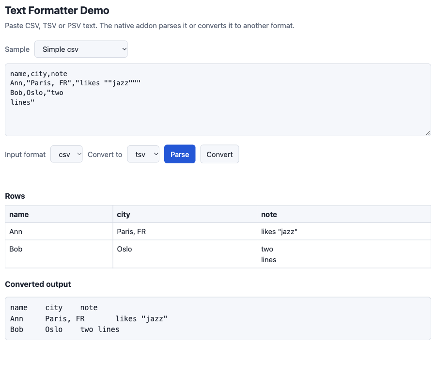

# neon-text-formatter

   

Read and convert CSV, TSV and PSV (pipe separated) text from Node. The parsing is done by a Rust addon built with [Neon](https://neon-bindings.com), so big files are fast: 2 million rows read in about 1.5 seconds on a 12-core laptop.

**Docs:** [Format guide](https://github.com/dimcher/neon-text-formatter/blob/master/docs/formats.md) · [Architecture](https://github.com/dimcher/neon-text-formatter/blob/master/docs/architecture.md) · [Testing](https://github.com/dimcher/neon-text-formatter/blob/master/docs/testing.md) · [Troubleshooting](https://github.com/dimcher/neon-text-formatter/blob/master/docs/troubleshooting.md) · [Contributing](https://github.com/dimcher/neon-text-formatter/blob/master/docs/contributing.md) · [Changelog](https://github.com/dimcher/neon-text-formatter/blob/master/CHANGELOG.md)

## What you get

- **One call to read.** `readArray` gives rows of cells, `readObject` uses the first row as keys.
- **One call to convert.** `convFile("a.csv", "a.tsv")` picks the format from the file extension.
- **Real CSV.** Quoted fields can hold commas, quotes and line breaks. A stray quote does not swallow the lines after it.
- **Clear errors.** A missing file, bad UTF-8 or an unknown extension throws a JS error with the reason.
- **Fast.** Big inputs are split across CPU cores. The result keeps the row order.
- **Checked.** Rust unit tests, a round-trip fuzz test, jest tests on the real addon, and a local browser demo.

## Quick start

The addon is built for the machine it is built on. Clone the repo, then:

```
npm install
npm run build:native
```

```js
const { readArray, readObject, convFile } = require("@dimcher/neon-text-formatter");

readArray("people.csv");
readObject("people.csv");
convFile("people.csv", "people.tsv");
```

The addon uses Node-API, so one build loads on any supported Node version. Needs Node 16 or newer and a [Rust toolchain](https://rustup.rs). If something fails, see [Troubleshooting](https://github.com/dimcher/neon-text-formatter/blob/master/docs/troubleshooting.md).

## Live samples

These are real results from the addon, for the file [`samples/people.csv`](samples/people.csv). It has a comma inside a quoted cell, doubled quotes, and a cell with a line break:

```
name,city,note
Ann,"Paris, FR","likes ""jazz"""
Bob,Oslo,"two
lines"
```

<!-- samples:start -->
**Read rows**

```js
readArray("samples/people.csv")
```

```js
[
  ["name","city","note"],
  ["Ann","Paris, FR","likes \"jazz\""],
  ["Bob","Oslo","two\nlines"]
]
```

**Read objects**

```js
readObject("samples/people.csv")
```

```js
[
  {"name":"Ann","city":"Paris, FR","note":"likes \"jazz\""},
  {"name":"Bob","city":"Oslo","note":"two\nlines"}
]
```

**Convert to TSV**

```js
convFile("samples/people.csv", "people.tsv")
```

```text
name<TAB>city<TAB>note\r\n
Ann<TAB>Paris, FR<TAB>likes "jazz"\r\n
Bob<TAB>Oslo<TAB>two lines
```

**Convert to PSV**

```js
convFile("samples/people.csv", "people.psv")
```

```text
name|city|note\r\n
Ann|Paris, FR|likes "jazz"\r\n
Bob|Oslo|two lines
```
<!-- samples:end -->

Run `npm run samples` to see the same output on your machine. The `samples:` block above is written by `npm run samples:write`, and a test fails if it no longer matches the real addon output. More cases are in the [format guide](https://github.com/dimcher/neon-text-formatter/blob/master/docs/formats.md).

## Try it in a browser



Paste CSV, TSV or PSV text, then parse it or convert it. The page calls the real addon through a small local server. See [Try it in a browser](#run-the-demo) below for how to start it.

## API

All paths need a file extension: `csv`, `tsv` or `psv` (any letter case) for the readers and converters. Any other extension throws. Every function throws a JS error when a file cannot be read or written, when a file is not valid UTF-8, or when a file name has no extension. Before 0.2.0 these cases returned an empty string, an empty array or `0`.

| Function | Returns | What it does |
|---|---|---|
| `readArray(source)` | `string[][]` | Reads a file into rows of cells. Rows can have different lengths. |
| `readObject(source)` | `object[]` | Uses the first row as keys. Each later row becomes an object. |
| `convFile(source, target)` | `number` | Reads `source`, writes it to `target` in the format of the target extension. Returns the bytes written. |
| `convText(text, target, delim)` | `number` | Parses `text` split on `delim` (`","`, `"\t"` or `"\|"`), writes it to `target`. Returns the bytes written. `delim` must be exactly one character. |
| `readText(source)` | `string` | Reads a whole file as text. Any extension works. |
| `writeText(text, target)` | `number` | Writes text to a file. Any extension works. Returns the bytes written. |
| `fileTypes()` | `object` | `{ csv: ",", tsv: "\t", psv: "\|" }` |

### Examples

```js
readArray("in.csv");
```

For a file with the lines `name,age` and `ann,30` this returns `[["name", "age"], ["ann", "30"]]`.

```js
readObject("in.csv");
```

For the same file this returns `[{ name: "ann", age: "30" }]`. A row with fewer cells than the header gets only the keys it has. Cells beyond the header are dropped. When a header name repeats, the last value wins.

```js
convText("a\tb\n1\t2", "out.psv", "\t");
```

This writes `a|b` and `1|2` to `out.psv`.

## Format rules

**CSV reading**
- A quote opens a quoted field only at the start of a field. Inside a quoted field, `""` is one quote.
- A quoted field can hold commas and line breaks, so one record can span several lines.
- A quote that closes but is not followed by a comma, a line break or the end of the file is treated as a mistake. That record is then read line by line instead of swallowing the lines after it.
- A quoted field that never closes also falls back to one row per line.
- Both `\n` and `\r\n` line endings work.

**TSV and PSV reading** have no quoting. Every line is a row, and every tab (or pipe) starts a new cell.

**Writing**
- Rows are joined with `\r\n`, with no line break after the last row.
- CSV: every cell is wrapped in quotes and quotes inside a cell are doubled. Line breaks and commas are kept, so the file reads back the same.
- TSV and PSV: there is no quoting, so a line break, a tab (or a pipe) inside a cell is replaced with a space. This loses information on purpose. A last row that holds only one empty cell cannot survive a TSV or PSV round trip either.

## Build and test

Needs Node 16 or newer and a Rust toolchain.

| Command | What it does |
|---|---|
| `npm run build:native` | Builds the Rust addon and copies it to `neon/native/index.node`. |
| `npm test` | Runs the jest tests. The addon tests are skipped until the addon is built. With `REQUIRE_ADDON=1` they fail instead of skipping. |
| `npm run test:rust` | Runs the Rust tests for the parsing and file code in `neon/core`. |
| `npm run test:all` | Builds the addon, then runs the Rust tests and the jest tests with `REQUIRE_ADDON=1`. |
| `npm run demo` | Starts the browser demo (see below). |

The Rust tests include a round-trip fuzz test: 3,000 random tables are written to CSV and read back, and must come out the same.

## Run the demo

This needs a git clone of the repo; the npm package does not include the demo. Run `npm run build:native`, then `npm run demo` and open http://127.0.0.1:4321. Paste CSV, TSV or PSV text, then parse it or convert it. The page calls the real addon through a small local server (`PORT` changes the port). The server only answers requests for 127.0.0.1 or localhost from the page itself, and refuses bodies over 1 MB.

## More documentation

- [Format guide](https://github.com/dimcher/neon-text-formatter/blob/master/docs/formats.md): how each format reads and writes, with real results for the odd cases.
- [Architecture](https://github.com/dimcher/neon-text-formatter/blob/master/docs/architecture.md): how the code is laid out, how a read works, how threads are used, and how fast it is.
- [Testing](https://github.com/dimcher/neon-text-formatter/blob/master/docs/testing.md): the test sets and how to run them.
- [Troubleshooting](https://github.com/dimcher/neon-text-formatter/blob/master/docs/troubleshooting.md): build errors, load errors and common surprises.
- [Contributing](https://github.com/dimcher/neon-text-formatter/blob/master/docs/contributing.md): branches, checks and code style.
- [Changelog](https://github.com/dimcher/neon-text-formatter/blob/master/CHANGELOG.md)
